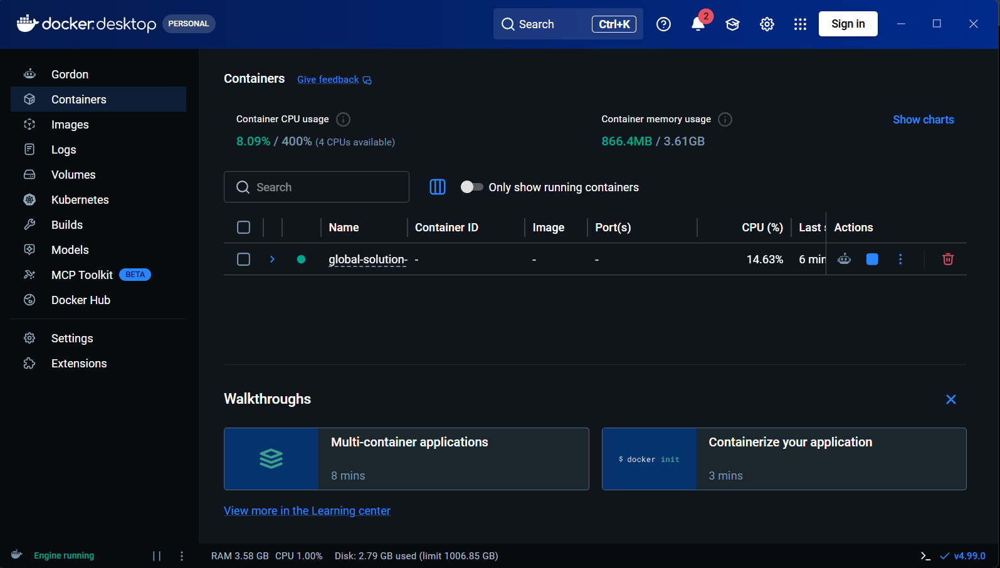
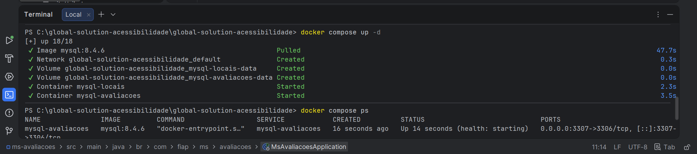
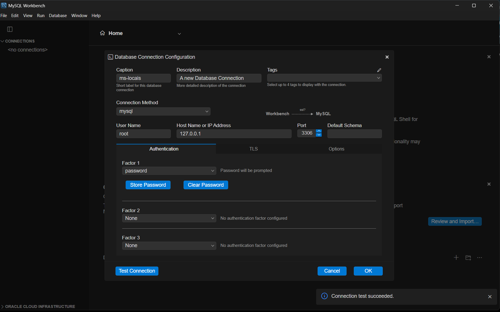
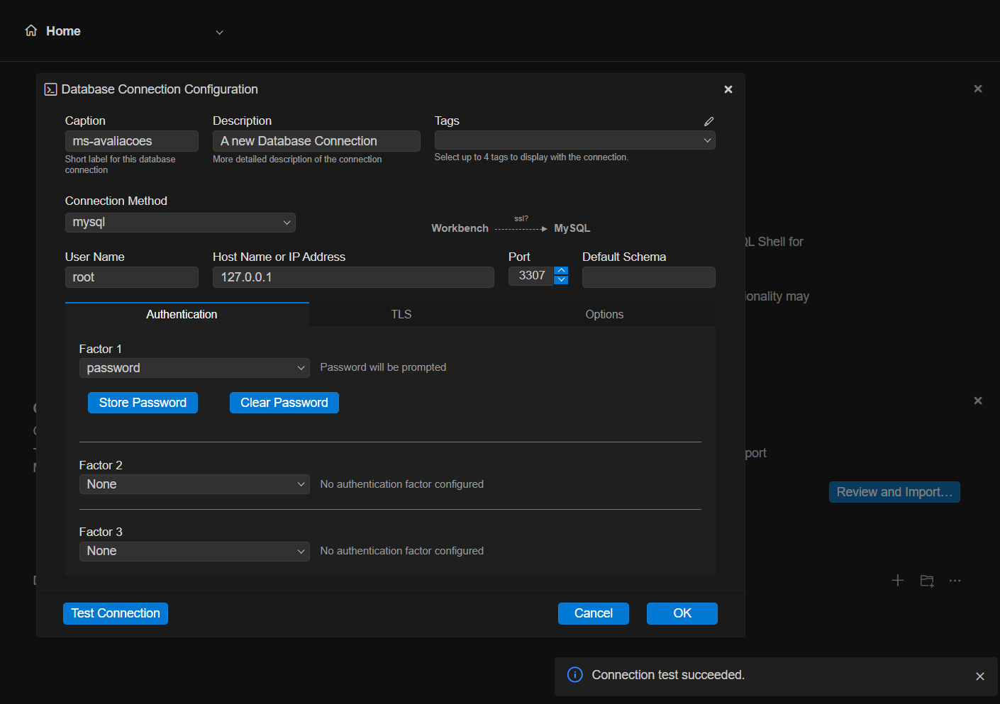
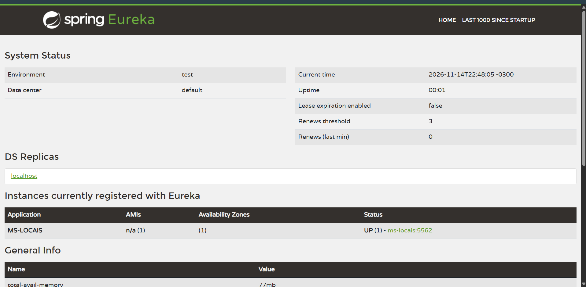
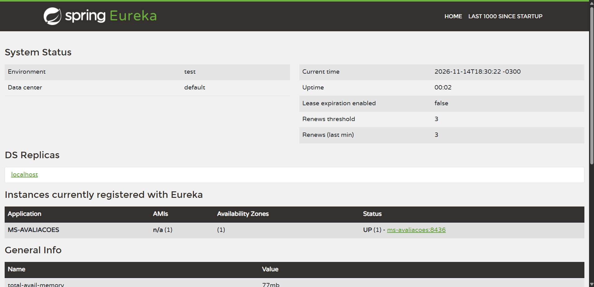

# Global Solution 2026-02 — Acessibilidade Inclusiva: Mobilidade sem Barreiras

**Disciplina:** Microservice and Web Engineering & IT Services  
**Turma:** 3SIPF  
**Instituição:** FIAP  

---

## Integrantes

| Integrante | RM |
|---|---|
| Lara Rosa Sodré | 555496 |
| Beatriz Matos Marques Rosa | 554805 |
| Keyla Dayana Magne Ala | 557630 |
---

## 1. Sobre o projeto

O projeto Global Solution — Acessibilidade Inclusiva: Mobilidade sem Barreiras propõe uma solução tecnológica para melhorar o acesso a informações sobre acessibilidade em estabelecimentos e espaços públicos.

A falta de informações sobre rampas, pisos táteis, recursos de comunicação e outras adaptações dificulta a autonomia e a circulação de pessoas com diferentes condições de mobilidade e deficiência.

A solução busca centralizar informações sobre locais e seus recursos de acessibilidade, além de permitir avaliações colaborativas sobre as condições encontradas nesses espaços.

Nesta entrega, o núcleo da solução foi desenvolvido utilizando uma arquitetura de microsserviços com comunicação síncrona.

## 2. Solução implementada

A aplicação é composta por dois microsserviços independentes:

### MS-Locais

Responsável pelo cadastro, consulta, atualização e exclusão de locais e seus respectivos recursos de acessibilidade.

Cada local pode possuir diferentes recursos, classificados conforme o tipo de deficiência:

- Física;
- Visual;
- Auditiva;
- Intelectual.

O microsserviço também controla o status de verificação dos locais:

- `CADASTRADO`: local cadastrado, ainda sem validação da comunidade.
- `VERIFICADO`: local cuja avaliação foi validada pelo outro microsserviço.

### MS-Avaliações

Responsável pelo cadastro, consulta, atualização e exclusão de avaliações colaborativas sobre os locais.

As avaliações armazenam informações como:

- Nome do usuário;
- Tipo de deficiência;
- Nota;
- Comentário;
- Barreira encontrada;
- Identificador do local avaliado.

Os status utilizados são:

- `REGISTRADA`: avaliação cadastrada.
- `VALIDADA`: avaliação validada com sucesso.
- `VALIDACAO_PENDENTE`: não foi possível concluir a comunicação com o MS-Locais.

### Comunicação entre os microsserviços

A comunicação ocorre de forma síncrona utilizando OpenFeign, Eureka Server e Load Balancer.

Quando uma avaliação é validada, o MS-Avaliações realiza uma chamada ao MS-Locais para atualizar o status do local de `CADASTRADO` para `VERIFICADO`.

A comunicação utiliza o nome lógico do serviço registrado no Eureka, sem depender de URLs fixas para localizar as instâncias.

Também foi implementado Circuit Breaker com Resilience4j e Fallback para tratar situações em que o MS-Locais esteja indisponível.

---

## 3. Arquitetura do projeto

A solução está organizada em um único repositório público (monorepo), contendo todos os componentes necessários para execução.

```text
global-solution-mobility/
│
├── api-gateway/
│   └── API Gateway - Porta 8082
│
├── eureka-server/
│   └── Service Discovery - Porta 8761
│
├── ms-locais/
│   └── Microsserviço de Locais
│
├── ms-avaliacoes/
│   └── Microsserviço de Avaliações
│
├── mysql_846/
│   └── docker-compose.yml
│
├── docs/
│   └── screenshots/
│
├── .gitignore
└── README.md
```

### Fluxo de comunicação

```text
                   CLIENTE
                      |
                      v
              API GATEWAY :8082
                      |
                      v
               EUREKA SERVER
                  :8761
                      |
          +-----------+-----------+
          |                       |
          v                       v
      MS-LOCAIS              MS-AVALIACOES
    Porta aleatória         Porta aleatória
          |                       |
          v                       |
       MySQL                     |
      :3306                      |
   db_locais                     |
                                  |
                                  |
                               MySQL
                               :3307
                           db_avaliacoes

       MS-AVALIACOES
              |
              | OpenFeign
              | Load Balancer
              | Circuit Breaker
              | Fallback
              |
              v
          MS-LOCAIS
```

Cada microsserviço possui seu próprio banco de dados, sem compartilhamento de schemas ou tabelas.

---

## 4. Tecnologias utilizadas

| Tecnologia | Utilização |
|---|---|
| Java 25 | Linguagem de programação |
| Spring Boot 4.0.9 | Desenvolvimento dos microsserviços e Gateway |
| Spring Cloud | Integração entre serviços |
| Spring Cloud Netflix Eureka | Registro e descoberta de serviços |
| Spring Cloud Gateway | Roteamento das requisições |
| OpenFeign | Comunicação síncrona entre microsserviços |
| Spring Cloud LoadBalancer | Distribuição de chamadas entre instâncias |
| Resilience4j | Circuit Breaker e tratamento de falhas |
| MySQL 8.4.6 | Persistência dos dados |
| Spring Data JPA | Persistência e acesso aos dados |
| Flyway | Criação, versionamento e carga inicial do banco |
| Swagger / OpenAPI | Documentação interativa das APIs |
| Maven | Gerenciamento de dependências e execução |
| Docker Compose | Inicialização dos bancos de dados |

---

## 5. Pré-requisitos

Antes de iniciar o projeto, é necessário ter instalado:

- JDK 25;
- Docker Desktop;
- Docker Compose;
- IntelliJ IDEA (opcional);
- Git (para clonar o repositório).

Não é necessário instalar o Maven separadamente, pois cada projeto possui seu próprio Maven Wrapper.

Verifique a instalação do Java:

```bash
java -version
```

Verifique a instalação do Docker:

```bash
docker --version
docker compose version
```

---

## 6. Como executar o projeto

As instruções abaixo consideram um ambiente local limpo, seguindo a estrutura do repositório.

### 6.1. Clonar o repositório

```bash
git clone https://github.com/lara-sodre/global-solution-mobility.git
```

Acesse a pasta do projeto:

```bash
cd global-solution-mobility
```

### 6.2. Iniciar os bancos de dados MySQL

O projeto utiliza dois bancos independentes, inicializados por meio do Docker Compose.

O arquivo de configuração está localizado em:

```text
mysql_846/docker-compose.yml
```

Na raiz do projeto, execute:

```bash
docker compose -f mysql_846/docker-compose.yml up -d
```

Verifique os containers:

```bash
docker compose -f mysql_846/docker-compose.yml ps
```

Aguarde até que os dois serviços apresentem o estado `healthy`.

**Configuração dos bancos:**

| Configuração | MS-Locais | MS-Avaliações |
|---|---|---|
| Container | mysql-locais | mysql-avaliacoes |
| Banco | db_locais | db_avaliacoes |
| Host | localhost | localhost |
| Porta | 3306 | 3307 |
| Usuário | root | root |
| Senha | root | root |

As credenciais apresentadas são destinadas exclusivamente ao ambiente local de desenvolvimento.

Os bancos utilizam volumes Docker independentes para persistência dos dados.

### 6.3. Executar o Eureka Server

Abra um novo terminal na raiz do projeto.

Entre na pasta:

```bash
cd eureka-server
```

Execute:

**Windows:**

```powershell
.\mvnw.cmd spring-boot:run
```

**Linux / macOS:**

```bash
./mvnw spring-boot:run
```

Após a inicialização, acesse:

http://localhost:8761

O painel do Eureka permite visualizar os microsserviços registrados.

### 6.4. Executar o MS-Locais

Abra outro terminal na raiz do projeto.

```bash
cd ms-locais
```

**Windows:**

```powershell
.\mvnw.cmd spring-boot:run
```

**Linux / macOS:**

```bash
./mvnw spring-boot:run
```

O microsserviço utiliza uma porta aleatória (`server.port=0`) e realiza seu registro no Eureka Server.

Na primeira execução, o Flyway executará automaticamente as migrations responsáveis pela criação das tabelas e inserção dos dados iniciais.

### 6.5. Executar o MS-Avaliações

Abra outro terminal na raiz do projeto.

```bash
cd ms-avaliacoes
```

**Windows:**

```powershell
.\mvnw.cmd spring-boot:run
```

**Linux / macOS:**

```bash
./mvnw spring-boot:run
```

O microsserviço também utiliza uma porta aleatória e realiza seu registro no Eureka Server.

O Flyway executará as migrations correspondentes ao banco `db_avaliacoes`.

### 6.6. Executar o API Gateway

Abra outro terminal na raiz do projeto.

```bash
cd api-gateway
```

**Windows:**

```powershell
.\mvnw.cmd spring-boot:run
```

**Linux / macOS:**

```bash
./mvnw spring-boot:run
```

O Gateway será iniciado na porta fixa `8082` e utilizará o Eureka para localizar as instâncias disponíveis dos microsserviços.

### 6.7. Ordem de inicialização

Para garantir o funcionamento correto da aplicação, siga esta ordem:

1. Docker e bancos MySQL;
2. Eureka Server;
3. MS-Locais;
4. MS-Avaliações;
5. API Gateway.

Cada componente deve permanecer em execução em seu próprio terminal.

### 6.8. Executar múltiplas instâncias

Os microsserviços estão configurados com `server.port=0`, permitindo que diferentes instâncias sejam iniciadas em portas aleatórias.

Para testar múltiplas instâncias:

1. Inicie uma instância do microsserviço.
2. Abra outro terminal.
3. Execute novamente o mesmo comando de inicialização.
4. Verifique no Eureka se as instâncias foram registradas.
5. Realize requisições para observar a distribuição de chamadas pelo Load Balancer.

---

## 7. Endereços de acesso

| Componente | Endereço |
|---|---|
| Eureka Server | http://localhost:8761 |
| API Gateway | http://localhost:8082 |
| MS-Locais via Gateway | http://localhost:8082/ms-locais/api/v1/locais |
| MS-Avaliações via Gateway | http://localhost:8082/ms-avaliacoes/api/v1/avaliacoes |

### Swagger / OpenAPI

Cada microsserviço possui documentação OpenAPI e Swagger UI.

Como os microsserviços utilizam portas aleatórias, consulte o log de inicialização para identificar a porta atribuída a cada instância.

Acesse:

```text
http://localhost:PORTA/swagger-ui/index.html
```

Substitua `PORTA` pela porta apresentada no log do respectivo microsserviço.

Também é possível consultar a especificação OpenAPI:

```text
http://localhost:PORTA/v3/api-docs
```

---

## 8. Endpoints disponíveis

Todas as rotas dos microsserviços utilizam versionamento de API na versão 1.

### 8.1. MS-Locais

Prefixo:

```text
/api/v1/locais
```

| Método | Endpoint | Descrição |
|---|---|---|
| GET | `/api/v1/locais` | Lista todos os locais |
| GET | `/api/v1/locais/{id}` | Busca um local pelo identificador |
| POST | `/api/v1/locais` | Cadastra um novo local |
| PUT | `/api/v1/locais/{id}` | Atualiza um local |
| PUT | `/api/v1/locais/{localId}/avaliacao/validada` | Atualiza o status do local para VERIFICADO |
| DELETE | `/api/v1/locais/{id}` | Exclui um local |

### 8.2. MS-Avaliações

Prefixo:

```text
/api/v1/avaliacoes
```

| Método | Endpoint | Descrição |
|---|---|---|
| GET | `/api/v1/avaliacoes` | Lista todas as avaliações |
| GET | `/api/v1/avaliacoes/{id}` | Busca uma avaliação pelo identificador |
| POST | `/api/v1/avaliacoes` | Registra uma nova avaliação |
| PUT | `/api/v1/avaliacoes/{id}` | Atualiza uma avaliação |
| PATCH | `/api/v1/avaliacoes/{id}/validar` | Valida uma avaliação e comunica com o MS-Locais |
| DELETE | `/api/v1/avaliacoes/{id}` | Exclui uma avaliação |

As operações de criação retornam HTTP 201 e a URI do recurso criado.

As operações de exclusão retornam HTTP 204 quando realizadas com sucesso.

---

## 9. Testes da aplicação

Os testes podem ser realizados pelo Swagger UI, Postman ou terminal.

Todos os exemplos abaixo utilizam o API Gateway como ponto de entrada.

### 9.1. Consultar os dados iniciais

Listar locais:

```bash
curl http://localhost:8082/ms-locais/api/v1/locais
```

Listar avaliações:

```bash
curl http://localhost:8082/ms-avaliacoes/api/v1/avaliacoes
```

Os dados iniciais são inseridos automaticamente pelas migrations do Flyway.

### 9.2. Cadastrar um local

```bash
curl -X POST http://localhost:8082/ms-locais/api/v1/locais \
-H "Content-Type: application/json" \
-d '{
  "nome": "Cinema Central",
  "endereco": "Rua do Cinema, 45",
  "cidade": "São Paulo",
  "tipoLocal": "CINEMA",
  "recursos": [
    {
      "descricao": "Espaço reservado para cadeira de rodas",
      "tipoDeficiencia": "FISICA",
      "disponivel": true,
      "localizacao": "Sala 1",
      "observacao": "Dois espaços por sessão"
    },
    {
      "descricao": "Sessões com audiodescrição",
      "tipoDeficiencia": "VISUAL",
      "disponivel": true,
      "localizacao": "Todas as salas",
      "observacao": null
    },
    {
      "descricao": "Sessões com legendas",
      "tipoDeficiencia": "AUDITIVA",
      "disponivel": true,
      "localizacao": "Todas as salas",
      "observacao": "Legendas disponíveis"
    }
  ]
}'
```

### 9.3. Cadastrar uma avaliação

O exemplo utiliza o identificador de um local existente.

```bash
curl -X POST http://localhost:8082/ms-avaliacoes/api/v1/avaliacoes \
-H "Content-Type: application/json" \
-d '{
  "nomeUsuario": "João Pereira",
  "tipoDeficiencia": "FISICA",
  "nota": 5,
  "comentario": "Rampa na entrada e corredores largos.",
  "barreiraEncontrada": null,
  "localId": 1
}'
```

### 9.4. Validar uma avaliação e testar a comunicação síncrona

Execute:

```bash
curl -X PATCH http://localhost:8082/ms-avaliacoes/api/v1/avaliacoes/1/validar
```

Após a validação, consulte o local:

```bash
curl http://localhost:8082/ms-locais/api/v1/locais/1
```

O status do local deverá ser atualizado para `VERIFICADO` após a comunicação síncrona entre os microsserviços.

### 9.5. Testar Circuit Breaker e Fallback

1. Mantenha Eureka, Gateway e os bancos em execução.
2. Pare todas as instâncias do MS-Locais.
3. Realize uma requisição para validar uma avaliação pelo MS-Avaliações.
4. Quando ocorrer a falha de comunicação, o Circuit Breaker e o Fallback deverão tratar a indisponibilidade.
5. A API deverá retornar HTTP 503 e a avaliação deverá permanecer com status `VALIDACAO_PENDENTE`.
6. Reinicie o MS-Locais e aguarde seu registro no Eureka.
7. Realize uma nova validação para verificar a comunicação novamente.

### 9.6. Testar Load Balancer

1. Inicie duas instâncias do MS-Locais.
2. Acesse o painel do Eureka.
3. Verifique se as duas instâncias estão registradas.
4. Realize chamadas que utilizem o MS-Locais por meio da comunicação entre microsserviços.
5. Verifique a distribuição das chamadas entre as instâncias disponíveis.

### 9.7. Testar validações e exceções

Para testar a validação de campos, envie uma requisição com informações inválidas, como um tipo de deficiência não permitido.

Exemplo:

```json
{
  "nomeUsuario": "João Pereira",
  "tipoDeficiencia": "XYZ",
  "nota": 8,
  "comentario": "Teste de validação",
  "barreiraEncontrada": null,
  "localId": 1
}
```

A aplicação deverá rejeitar os dados inválidos.

Também é possível testar a busca de um identificador inexistente:

```bash
curl http://localhost:8082/ms-locais/api/v1/locais/999
```

A resposta esperada é HTTP 404.

---

## 10. Persistência e migrations

Cada microsserviço possui seu próprio banco MySQL.

### Banco db_locais

As migrations estão em:

```text
ms-locais/src/main/resources/db/migration/
```

Arquivos:

- `V1__create_tb_local.sql`
- `V1.1__insert_tb_local.sql`
- `V2__create_tb_recurso_acessibilidade.sql`
- `V2.1__insert_tb_recurso_acessibilidade.sql`

Tabelas criadas:

- `tb_local`
- `tb_recurso_acessibilidade`
- `flyway_schema_history`

### Banco db_avaliacoes

As migrations estão em:

```text
ms-avaliacoes/src/main/resources/db/migration/
```

Arquivos:

- `V1__create_tb_avaliacao.sql`
- `V1.1__insert_tb_avaliacao.sql`

Tabelas criadas:

- `tb_avaliacao`
- `flyway_schema_history`

As migrations são executadas automaticamente na inicialização dos respectivos microsserviços.

---

## 11. Organização em camadas

Os microsserviços seguem arquitetura em camadas, com separação de responsabilidades:

| Camada | Responsabilidade |
|---|---|
| Entity | Representação das entidades e dados persistidos |
| DTO | Objetos de entrada e saída das APIs |
| Repository | Acesso e persistência dos dados |
| Service | Regras de negócio e operações da aplicação |
| Controller | Exposição dos endpoints e respostas HTTP |
| Exceptions | Tratamento de exceções e erros personalizados |
| Config | Configurações dos componentes |
| Client | Comunicação com outros microsserviços por OpenFeign |

As entidades não são expostas diretamente nos endpoints. As requisições e respostas utilizam DTOs específicos.

---

## 12. Evidências de execução

As imagens abaixo documentam a configuração e a execução dos componentes do projeto.

### Docker



### Inicialização dos containers pelo terminal



### Banco de dados — MS-Locais



### Banco de dados — MS-Avaliações



### Registro do MS-Locais no Eureka



### Registro do MS-Avaliações no Eureka



---

## 13. Encerramento da aplicação

Para interromper os microsserviços, utilize `Ctrl + C` nos respectivos terminais.

Para interromper os containers MySQL, execute na raiz do projeto:

```bash
docker compose -f mysql_846/docker-compose.yml down
```

Esse comando remove os containers, mas preserva os volumes de dados.

**Atenção:** não utilize `docker compose down -v` se desejar preservar os dados armazenados nos bancos.

---

## 14. Repositório

O código-fonte completo está disponível publicamente no GitHub:

**https://github.com/lara-sodre/global-solution-mobility**

---

**Global Solution 2026-02 — FIAP**  
*Acessibilidade Inclusiva: Mobilidade sem Barreiras.*